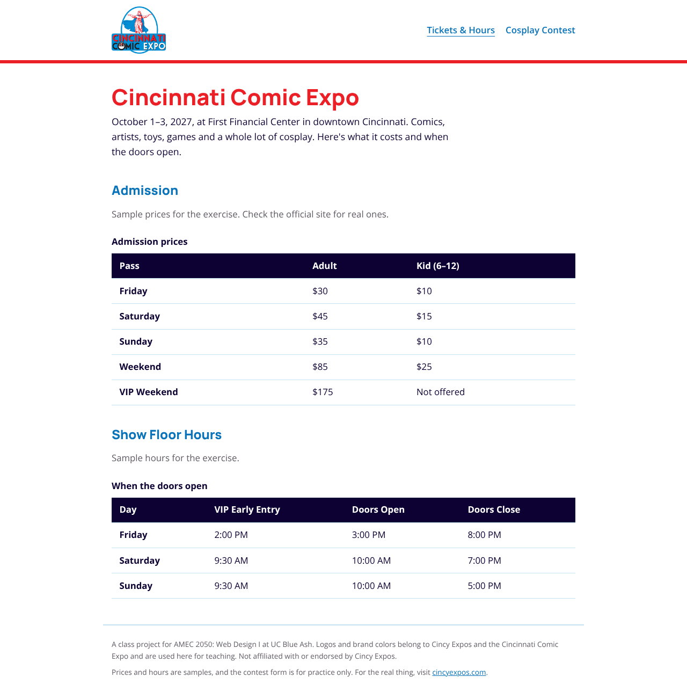
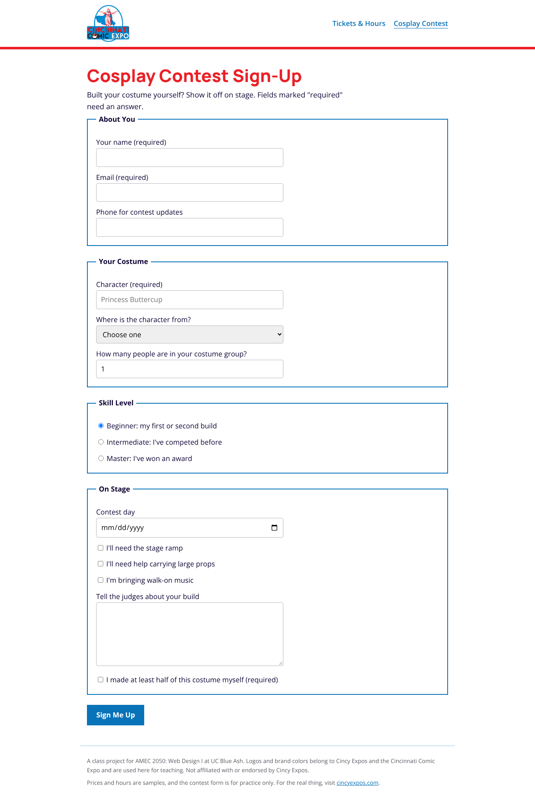

# 📄 Cincinnati Comic Expo: Tables and Forms

## 🎯 Overview

The Cincinnati Comic Expo site has two pages: **Tickets & Hours** (`index.html`) and **Cosplay Contest**
(`cosplay.html`). The header, footer, colors and fonts are already done in `css/base.css`. Each page is missing its main
content. In **Part 1** you'll build the two data tables on the tickets page and style them in `css/tables.css`. In
**Part 2** you'll build the contest sign-up form on the cosplay page and style it in `css/forms.css`. Both parts use the
color variables from `base.css`.

The HTML comments in `index.html` and `cosplay.html` list the exact content for every table and form field. Build your
markup where each comment is, then delete the comment.

## 📋 Requirements

### Part 1: Tickets & Hours tables

- [ ] `index.html` has two data tables, Admission and Show Floor Hours, with all of the data from the HTML comments
- [ ] Each table has a `caption`, a `thead` and a `tbody`
- [ ] Column headers and row headers are `th` elements with the correct `scope` (`col` or `row`)
- [ ] Each table is wrapped in `
`
- [ ] In `css/tables.css`, the tables are full width with collapsed borders, a dark header row, padded cells, a line
  under each row and a styled caption
- [ ] On a phone, a wide table scrolls sideways inside its `.table-scroll` box, and the page itself doesn't

### Part 2: Cosplay Contest form

- [ ] `cosplay.html` has one `form` with four `fieldset`s, each with a `legend`
- [ ] Each field uses the right input type, plus a `select` and a `textarea`, and is wrapped in `
`
- [ ] Radio buttons in the same group share a `name`, and the form ends with a submit button
- [ ] Every field has a `label` connected with matching `for` and `id` values
- [ ] The `required`, `autocomplete`, `placeholder`, `min`, `max`, `value`, `rows` and `checked` attributes from the
  HTML comment are in place
- [ ] In `css/forms.css`, fieldsets have borders, labels sit above their fields, fields are a consistent size and the
  button is styled
- [ ] A required field gets a red border with `:user-invalid`, only after the user has typed in it or tried to submit

### Both parts

- [ ] Every color comes from the variables in `css/base.css`. Don't edit `base.css`.
- [ ] Your formatting matches `base.css`, the HTML passes the
  [W3C Markup Validator](https://validator.w3.org/#validate_by_input), and you don't add extra classes or inline styles

## 🖼️ Example Output

These are the finished pages at desktop width. Your spacing can be slightly different, but each page should look very
close to these.

| Tickets & Hours (`index.html`) | Cosplay Contest (`cosplay.html`) |
| --- | --- |
|  |  |

Things the screenshots don't show:

- On a phone, wide tables scroll sideways inside their `.table-scroll` box. The page itself does not.
- A required field gets a red border only **after** the user types in it and leaves it, or tries to submit. It's not
  red when the page first loads.
- Clicking a label puts the cursor in its field, or checks its checkbox or radio button.

## 📂 Starter Files

| File / Folder | Purpose | What you do |
| --- | --- | --- |
| `index.html` | Tickets & Hours page | Build the two tables (Part 1) |
| `css/tables.css` | Table styles, linked from `index.html` | Style the tables (Part 1) |
| `cosplay.html` | Cosplay Contest page | Build the sign-up form (Part 2) |
| `css/forms.css` | Form styles, linked from `cosplay.html` | Style the form (Part 2) |
| `css/base.css` | Colors, fonts, header, footer and layout | Nothing. Leave it alone and use its variables. |
| `images/logo.webp` | Expo logo | Nothing |

## 🧮 Grading

| Criteria | Full credit | Partial credit | No credit | Points |
| --- | --- | --- | --- | --- |
| **Table markup** | Both tables have a caption, `thead` and `tbody`, `th` with the correct `scope` for column and row headers, the `.table-scroll` wrapper, and all data entered correctly | A caption, `scope` or wrapper is missing, or a few values are wrong | No tables, or the data is not in a `table` | 4 |
| **Table styles** | Full-width collapsed tables with a dark header row, padded cells, row lines, a styled caption and sideways scrolling on small screens | Some styles are missing or don't match the example | Tables are unstyled | 2 |
| **Form markup** | One form with four fieldsets and legends, the correct input types, a select, a textarea, `.field` wrappers, matching radio `name`s and a submit button | A fieldset, input type or wrapper is missing or wrong | No form | 3 |
| **Labels and attributes** | Every field has a `label` connected with `for` and `id`, and the `required`, `autocomplete`, `placeholder`, `min`, `max`, `value`, `rows` and `checked` attributes are in place | A few labels aren't connected, or some attributes are missing | Most fields have no label | 2 |
| **Form styles** | Bordered fieldsets, labels above fields, consistent field sizing, red `:user-invalid` borders and a styled button | Some styles are missing, or invalid fields aren't highlighted | Form is unstyled | 2 |
| **Variables and code quality** | Colors come only from the `base.css` variables, formatting matches `base.css`, the HTML validates, no extra classes, clear commit messages | A few hard-coded colors, validator errors, formatting issues or vague commits | Messy code, inline styles or edits to `base.css` | 2 |
| **Total** | | | | **15** |

## 📚 Resources

- [MDN: HTML table basics](https://developer.mozilla.org/en-US/docs/Learn_web_development/Core/Structuring_content/HTML_table_basics)
- [MDN: HTML table accessibility](https://developer.mozilla.org/en-US/docs/Learn_web_development/Core/Structuring_content/Table_accessibility)
  (`caption`, `thead`, `tbody` and `scope`)
- [MDN: Styling tables](https://developer.mozilla.org/en-US/docs/Learn_web_development/Core/Styling_basics/Tables)
- [MDN: Your first form](https://developer.mozilla.org/en-US/docs/Learn_web_development/Extensions/Forms/Your_first_form)
- [MDN: How to structure a web form](https://developer.mozilla.org/en-US/docs/Learn_web_development/Extensions/Forms/How_to_structure_a_web_form)
- [MDN: The `<input>` element and its types](https://developer.mozilla.org/en-US/docs/Web/HTML/Reference/Elements/input)
- [MDN: `:user-invalid`](https://developer.mozilla.org/en-US/docs/Web/CSS/:user-invalid)
- [W3C Markup Validation Service](https://validator.w3.org/#validate_by_input)

## 🆘 Getting Help

Ask during class or office hours, or post on the Canvas discussion board. If a label won't connect to its field, check
that the label's `for` matches the input's `id` exactly. If a table looks lopsided, count the cells in each row.

---

The AI policy and submission instructions are in the [README](../README.md).
